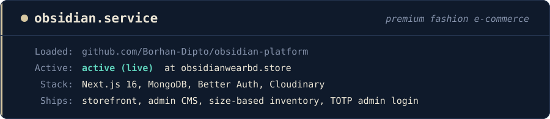

<p align="center">
  
</p>

<p align="center">
  <a href="https://obsidianwearbd.store"></a>
  
  
  
  
</p>

# OBSIDIAN Platform

The complete e-commerce platform behind **[OBSIDIAN](https://obsidianwearbd.store)**, a premium clothing brand in Bangladesh. It includes a cinematic storefront, customer accounts and a full admin CMS — so the whole website, from the homepage to the size guide, can be managed without touching code.

## ✨ Features

**Storefront**
- Premium motion system: cinematic logo reveal, animated homepage, shop and product pages
- Predictive search, hover photos, photo viewer and a sticky buy bar
- **Size-based inventory** with stock hints, "notify me" requests and fit references
- Cart reconciliation against live stock, coupons and complementary product suggestions
- Product FAQ, delivery info, size guide and clean collection URLs

**Customer accounts**
- Register, log in, reset password, saved addresses and order history
- Order tracking and downloadable order documents

**Admin CMS**
- Products, collections, coupons, customers, orders and newsletter
- Edit every page section — homepage, navbar, footer, about, contact, journal and more
- Admin security with **authenticator-app (TOTP) 2-step login** and **audit logs**

**Growth & quality**
- Meta Pixel e-commerce events + **Conversions API**, GA4 and catalogue feed
- Technical SEO: canonicals, structured data, sitemap and return-policy schema
- Email and SMS notifications with automatic retries
- CI pipeline on every push: **secret scanning**, lint, tests, build and `npm audit`

## 🛠️ Tech stack

| Layer | Technology |
| --- | --- |
| Framework | Next.js 16 (App Router), React 19 |
| Database | MongoDB |
| Authentication | Better Auth (+ bcrypt) |
| Media | Cloudinary, Sharp |
| Styling | Tailwind CSS v4 |
| Notifications | Resend (email), Twilio (SMS) |
| Testing & CI | Node test runner, ESLint, GitHub Actions |
| Hosting | Vercel |

## 🚀 Getting started

```bash
git clone https://github.com/Borhan-Dipto/obsidian-platform.git
cd obsidian-platform
npm install
npm run dev
```

Then open <http://localhost:3000>.

### Useful scripts

| Command | What it does |
| --- | --- |
| `npm run dev` | Start the development server |
| `npm run build` | Production build |
| `npm run lint` | Run ESLint |
| `npm test` | Run critical and integration tests |
| `npm run ci:verify` | Everything CI runs: secret scan, lint, tests, build, audit |

### Environment variables

Create a `.env.local` file (never commit it). The main ones:

| Variable | Purpose |
| --- | --- |
| `MONGODB_URI`, `MONGODB_DB` | Database connection |
| `BETTER_AUTH_SECRET`, `BETTER_AUTH_URL`, `CUSTOMER_AUTH_SECRET` | Authentication |
| `CLOUDINARY_CLOUD_NAME`, `CLOUDINARY_API_KEY`, `CLOUDINARY_API_SECRET` | Image uploads |
| `NEXT_PUBLIC_SITE_URL` | Public site address |
| `NEXT_PUBLIC_META_PIXEL_ID`, `META_CAPI_ACCESS_TOKEN`, `NEXT_PUBLIC_GA4_MEASUREMENT_ID` | Tracking |
| `RESEND_API_KEY`, `TWILIO_ACCOUNT_SID`, `TWILIO_AUTH_TOKEN`, `TWILIO_SMS_FROM` | Email and SMS |
| `CRON_SECRET`, `PUBLIC_API_SECURITY_SECRET` | Protect internal endpoints |

## 📁 Project structure

```
src/
├── app/          # Storefront, account, admin and API routes
├── components/   # UI and admin components
├── context/      # Cart and app state
├── lib/          # Database, auth, settings, tracking helpers
└── providers/
tests/            # Critical and integration tests
scripts/ci/       # CI checks, including secret scanning
```

---

<p align="center">Built by <a href="https://github.com/Borhan-Dipto">Borhan Dipto</a></p>
